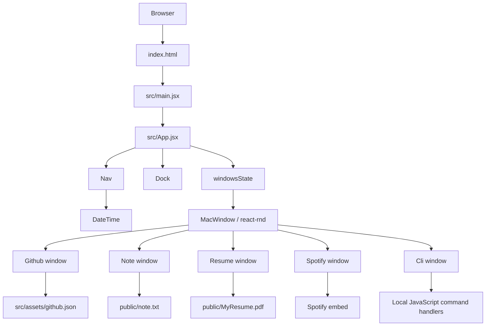
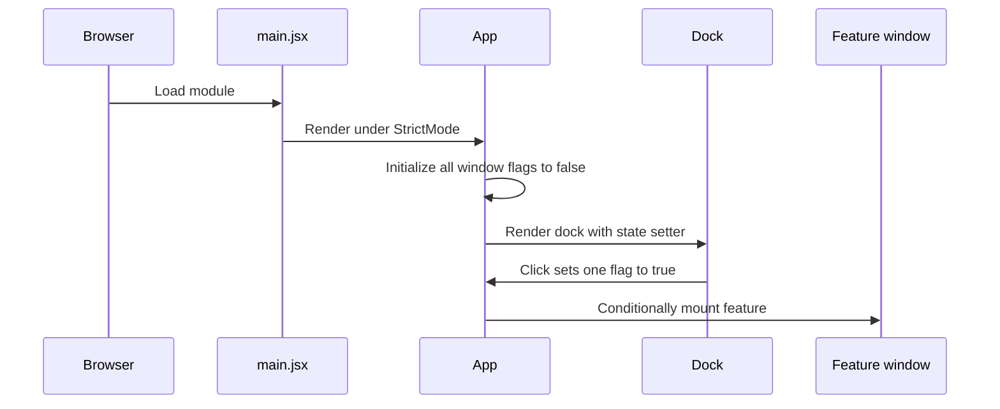

# Web-based macOS — Technical Reference

This document describes the active implementation on the repository's main branch. It is a code-level reference for the component tree, state lifecycle, interactions, data contracts, resource loading, deployment, and implementation limitations. It does not assume backend functionality that the source does not contain.

## Contents

- [1. Scope and architecture](#1-scope-and-architecture)
- [2. Repository map](#2-repository-map)
- [3. Startup and build lifecycle](#3-startup-and-build-lifecycle)
- [4. Window state and lifecycle](#4-window-state-and-lifecycle)
- [5. Component reference](#5-component-reference)
- [6. Interaction walkthroughs](#6-interaction-walkthroughs)
- [7. Static data and assets](#7-static-data-and-assets)
- [8. Network and external interfaces](#8-network-and-external-interfaces)
- [9. Dependencies and configuration](#9-dependencies-and-configuration)
- [10. Styling system](#10-styling-system)
- [11. Failure paths and implementation observations](#11-failure-paths-and-implementation-observations)
- [12. Troubleshooting](#12-troubleshooting)
- [13. Traceability reference](#13-traceability-reference)

## 1. Scope and architecture

### What the application is

Web-based macOS is a client-side portfolio presented as a macOS-inspired desktop. Visitors use the navigation bar and dock to open a project browser, Notes content, an embedded résumé, a Spotify playlist, or a simulated terminal. Internal windows can be dragged and resized.

It is not an operating system, and its terminal is not a real shell. The repository contains no application backend, API route registrations, database models or clients, authentication/session flow, message broker, worker, scheduler, or background job processor. Application behavior is implemented in browser JavaScript and React state, while content is delivered through static assets.

### Architecture



The active runtime path is index.html → src/main.jsx → src/App.jsx. The separate latest/src/App.jsx file is not imported by this entry point.

### Application interfaces

There are no application-defined API endpoints or JSON request/response contracts. The resource interactions implemented by the frontend are the Notes text fetch, PDF embedding, Spotify iframe, remote project images, and external navigation actions from the dock and terminal.

## 2. Repository map

| Path | Responsibility |
|---|---|
| index.html | HTML shell, root mount node, page title, favicon reference, module entry |
| src/main.jsx | Creates the React root and renders App inside StrictMode |
| src/App.jsx | Owns open-window state and composes Nav, Dock, and feature windows |
| src/app.scss | Global reset, viewport dimensions, base font size, desktop wallpaper |
| src/components/Nav.jsx | Static menu labels, Apple/Wi-Fi icons, and DateTime |
| src/components/DateTime.jsx | Browser-local clock and one-second update interval |
| src/components/Dock.jsx | Internal-window launchers and external link handlers |
| src/components/dock.scss | Dock layout, icon colors, hover transforms and blur |
| src/components/nav.scss | Top navigation bar styling |
| src/components/windows/MacWindow.jsx | Common title bar, close control, and react-rnd wrapper |
| src/components/windows/window.scss | Window surface, title bar, traffic-light dots and scrollbars |
| src/components/windows/Github.jsx | Project cards rendered from imported JSON |
| src/components/windows/github.scss | Project card layout and visual effects |
| src/components/windows/Note.jsx | Fetches and syntax-highlights public/note.txt |
| src/components/windows/note.scss | Notes scrolling and code block styling |
| src/components/windows/Resume.jsx | Embeds public/MyResume.pdf |
| src/components/windows/resume.scss | PDF embed sizing |
| src/components/windows/Spotify.jsx | Fixed Spotify playlist iframe |
| src/components/windows/spotify.scss | Spotify iframe container |
| src/components/windows/Cli.jsx | Hard-coded terminal banner and local command handlers |
| src/components/windows/cli.scss | Terminal layout, font treatment, blur and scanline overlay |
| src/assets/github.json | Five static project metadata objects |
| public/note.txt | Plain-text Notes window content |
| public/MyResume.pdf | Static résumé file |
| public/doc-icons/ | Dock SVG icons |
| public/navbar-icons/ | Navigation SVG icons |
| public/wallpaper.jpg, public/wallpaper2.jpg | Static desktop images |
| vite.config.js | Vite base path and React plugin |
| package.json, package-lock.json | Dependency declarations, locked tree, and scripts |
| eslint.config.js | Flat ESLint configuration |
| .gitignore | Ignores build, dependency, editor, and local files |
| latest/src/App.jsx | Minimal alternate file; not in the active import chain |
| public/vite.svg | Default Vite asset; not used by the active UI components |

The complete recursive repository tree includes the files listed above and their styles/assets. JSX imports SCSS directly, which Vite processes through Sass during development and build.

## 3. Startup and build lifecycle

### Startup walkthrough

1. The browser opens index.html.
2. The document defines the root element with id root and loads src/main.jsx as a JavaScript module.
3. main.jsx calls createRoot(document.getElementById("root")) and renders App under React StrictMode.
4. App imports the global stylesheet, Nav, Dock, and all five feature-window components.
5. App initializes windowsState with github, note, resume, spotify and cli set to false.
6. Nav and Dock render immediately; no feature window is mounted until its state flag becomes true.
7. A dock click changes the appropriate state flag to true.
8. React mounts the feature component, which wraps its content in MacWindow.
9. When Notes is mounted, its effect requests note.txt. DateTime maintains its clock interval while Nav is mounted.



### Package scripts

The active package.json declares:

| Command | Behavior |
|---|---|
| npm run dev | Starts Vite development server |
| npm run build | Builds static production files into dist/ |
| npm run preview | Serves the production build locally |
| npm run lint | Runs eslint . |
| npm run predeploy | Runs npm run build before deploy |
| npm run deploy | Publishes dist/ with gh-pages -d dist |

Local development:

```bash
npm install
npm run dev
```

Production verification:

```bash
npm run lint
npm run build
npm run preview
```

The direct Vite version range is ^7.2.4. Vite 7 requires Node.js 20.19+ or 22.12+; Node 18 is not supported by that major. See the [official Vite 7 guide](https://v7.vite.dev/guide/).

### Vite and deployment base

vite.config.js uses @vitejs/plugin-react and sets base to /Web_based_MAC_OS/ for the GitHub Pages repository subpath. There is no custom API proxy, server middleware, alias, app-specific environment variable, or backend build.

The deploy script publishes the generated dist directory. Successful hosting also depends on GitHub Pages configuration and repository permissions.

## 4. Window state and lifecycle

### Central state

src/App.jsx owns one React state object:

| Field | Type | Initial value | Rendered component when true |
|---|---|---|---|
| github | Boolean | false | Github |
| note | Boolean | false | Note |
| resume | Boolean | false | Resume |
| spotify | Boolean | false | Spotify |
| cli | Boolean | false | Cli |

The object records only whether each application is open. It does not store coordinates, dimensions, selected/focused window, minimized state, application data, or persistence metadata. State resets on page reload.

### Open flow

1. A dock icon click handler runs.
2. The handler calls setWindowsState with a functional updater.
3. The updater spreads the previous object and changes one field to true.
4. App rerenders and mounts the matching window.
5. The feature component passes its content, windowName and state setter into MacWindow.

Clicking an icon that is already open sets its flag to true again; it is not a toggle-close operation.

### Close flow

1. The red traffic-light element handles onMouseDown.
2. It stops event propagation.
3. The setter copies the current state and assigns false to the key named by windowName.
4. React unmounts the feature.
5. Clicking the dock icon later mounts a new instance with default frame geometry.

Yellow and green controls are decorative and do not minimize or maximize.

### Window geometry

MacWindow wraps content in react-rnd and configures the element whose class is nav as the drag handle. Resizing is enabled. Default x/y are 300/200, and normal windows default to 40vw by 40vh. Spotify passes width 35vw.

Positions and dimensions are not stored. There is no custom active-window/z-index manager, maximize behavior, geometry persistence, or minimize/restore workflow. Spotify.jsx also passes a style prop that MacWindow neither accepts nor forwards; that value has no effect in the current implementation.

## 5. Component reference

### App.jsx

App initializes the five Boolean flags, composes Nav and Dock, and conditionally renders Github, Note, Resume, Spotify and Cli. It passes windowName and setWindowsState to each internal window. It contains no fetch logic, API requests, authentication or database calls.

### Nav.jsx and DateTime.jsx

Nav renders the owner label, static File/Window/Terminal labels, Apple and Wi-Fi icons, and DateTime. The menu labels have no click handlers.

DateTime initializes state with new Date(), updates it every 1,000 milliseconds, and clears the interval on effect cleanup. It formats the browser-local weekday, month, date, and 12-hour time with zero-padded minutes. The clock isn't server-synchronized.

### Dock.jsx

| Dock icon | Action | Effect |
|---|---|---|
| GitHub | Internal application | Sets github=true; logs the current state object before updating |
| Note | Internal application | Sets note=true |
| PDF | Internal application | Sets resume=true |
| Calendar | Opens Google Calendar | External browser navigation |
| Spotify | Internal application | Sets spotify=true |
| Mail | Opens a mailto URL | Browser/OS mail-handler handoff |
| Link | Opens configured LinkedIn profile | External browser navigation |
| CLI | Internal application | Sets cli=true |

Dock images use import.meta.env.BASE_URL when building icon URLs. Click targets are div elements rather than semantic buttons; keyboard activation and explicit focus handling are not added.

### MacWindow.jsx

The common shell wraps each feature in Rnd. It renders children inside main-content, with a shared title bar and traffic-light dots. The red dot closes the window by setting the matching windowsState key to false. It does not persist geometry or implement yellow/green control behavior.

### Github.jsx — project browser

The module imports src/assets/github.json at build time and maps each record to a GitCard using project.id as the card key. Each card renders an image, title, description, technology tags, and link anchors.

There is a property-name mismatch in the current source:
- JSON fields are repoLink and demoLink.
- Github.jsx reads data.repolink and data.demolink.

JavaScript property names are case-sensitive. With current records, repository anchors do not receive their intended URL and the Demo Link conditional is false. The cards still render, but their intended links need the consumer and data names to be aligned.

The tags map does not assign a React key to each tag paragraph, which can produce React list-key warnings. The app does not call the GitHub API; project metadata is bundled JSON.

### Note.jsx — Notes content

On mount, Note initializes its content state to null and starts an effect that fetches note.txt using Vite's base path. It converts the response to text and stores it in state. Truthy content is passed to SyntaxHighlighter with the TypeScript language and atelierDuneDark theme; otherwise the component shows Loading.

react-markdown is imported but unused. The text is displayed as syntax-highlighted content rather than parsed into rich Markdown.

The fetch has no response.ok check, catch handler, retry, timeout, AbortController or explicit error UI. A failed request can leave Loading visible and create an unhandled rejection. An empty file also follows the Loading branch. React StrictMode may re-run effects in development; that is not a production retry policy.

### Resume.jsx — PDF viewer

Resume embeds public/MyResume.pdf with a URL built from Vite's base path. It does not parse, generate, upload, or download a PDF. Display depends on the asset being available and the browser supporting embedded PDF viewing.

### Spotify.jsx — playlist embed

The iframe loads this fixed playlist URL:

```text
https://open.spotify.com/embed/playlist/37i9dQZF1DX0XUfTFmNBRM?utm_source=generator&theme=0
```

The iframe uses lazy loading and permits autoplay, clipboard-write, encrypted-media, fullscreen, and picture-in-picture. The app does not use Spotify OAuth, the Spotify Web API, access tokens or playback callbacks. Spotify controls the player UI and playback experience.

The container has a minimum height of 450px. The feature passes width 35vw, but the extra style prop is ignored by MacWindow.

### Cli.jsx — simulated terminal

Cli uses react-console-emulator with a locally defined commands object. It does not spawn a terminal process, access a server filesystem, or execute operating-system commands.

| Command | Current handler |
|---|---|
| about | Returns hard-coded profile text |
| skills | Returns hard-coded skills and tools |
| projects | Returns a fixed numbered project list |
| experience | Returns fixed academic/project experience |
| contact | Returns name, location, GitHub and an email placeholder |
| github | Opens the GitHub profile in a new tab and returns a confirmation |
| resume | Returns “Resume download started...” but does not initiate a download |
| social | Returns GitHub and a LinkedIn placeholder |
| neofetch | Returns the simulated system banner |
| matrix | Returns a static “Connection Terminated” message |
| echo | Joins passed arguments with spaces |

The banner also lists help and clear, but neither has an application-defined handler in the local commands object. Any behavior depends on react-console-emulator. The displayed OS/kernel/host/uptime details are presentation copy, not real system information. Use the dock's PDF icon to open the actual résumé asset.
