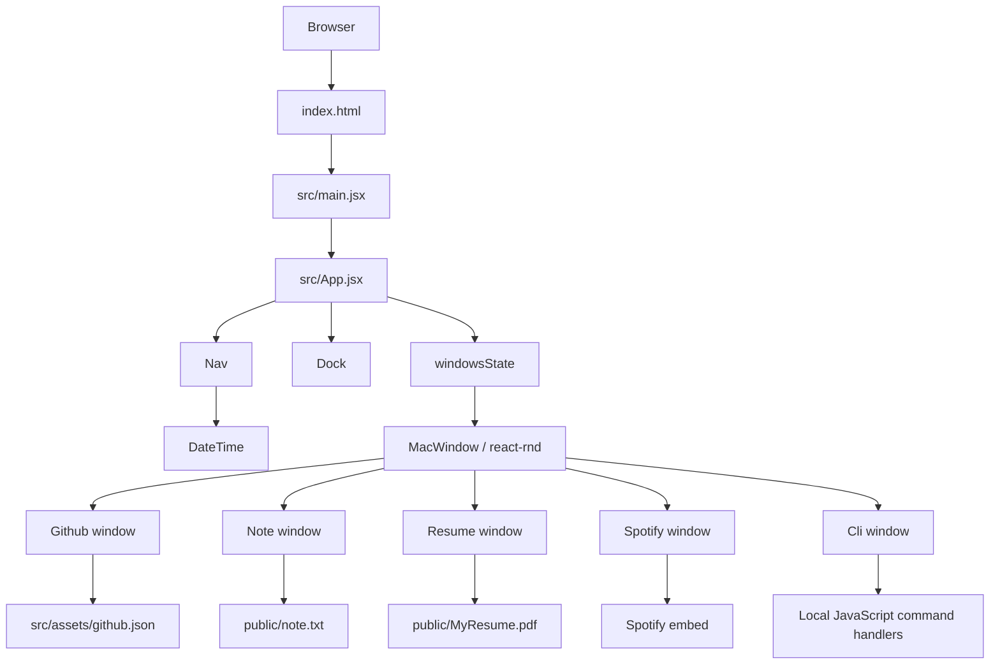
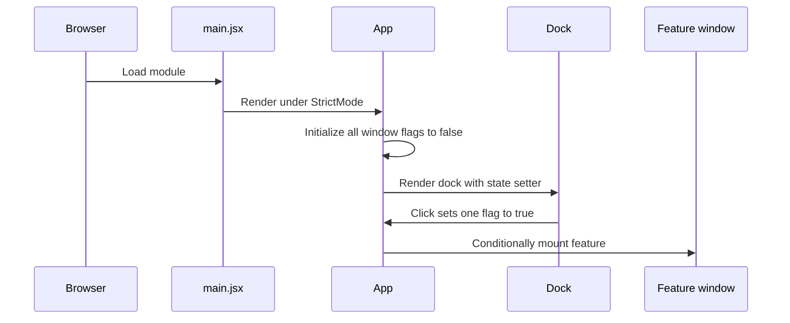
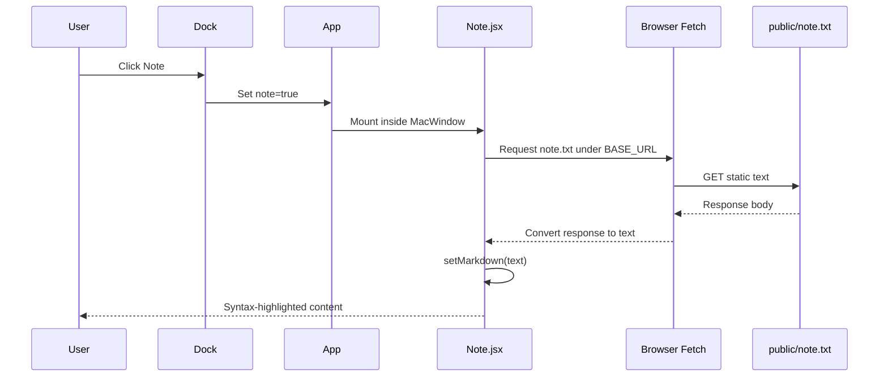

# Web-based macOS — Technical Reference

This document describes the active implementation on the repository's main branch. It is a code-level reference for the component tree, state lifecycle, interactions, data contracts, resource loading, deployment, and implementation limitations. It does not assume backend functionality that the source does not contain.

## Contents

- [1. Scope and architecture](#1-scope-and-architecture)
- [2. Repository map](#2-repository-map)
- [3. Startup and build lifecycle](#3-startup-and-build-lifecycle)
- [4. Window state and lifecycle](#4-window-state-and-lifecycle)
- [5. Component reference](#5-component-reference)
- [6. Interaction walkthroughs](#6-interaction-walkthroughs)
- [7. Static data and assets](#7-static-data-and-assets)
- [8. Network and external interfaces](#8-network-and-external-interfaces)
- [9. Dependencies and configuration](#9-dependencies-and-configuration)
- [10. Styling system](#10-styling-system)
- [11. Failure paths and implementation observations](#11-failure-paths-and-implementation-observations)
- [12. Troubleshooting](#12-troubleshooting)
- [13. Traceability reference](#13-traceability-reference)

## 1. Scope and architecture

### What the application is

Web-based macOS is a client-side portfolio presented as a macOS-inspired desktop. Visitors use the navigation bar and dock to open a project browser, Notes content, an embedded résumé, a Spotify playlist, or a simulated terminal. Internal windows can be dragged and resized.

It is not an operating system, and its terminal is not a real shell. The repository contains no application backend, API route registrations, database models or clients, authentication/session flow, message broker, worker, scheduler, or background job processor. Application behavior is implemented in browser JavaScript and React state, while content is delivered through static assets.

### Architecture



The active runtime path is index.html → src/main.jsx → src/App.jsx. The separate latest/src/App.jsx file is not imported by this entry point.

### Application interfaces

There are no application-defined API endpoints or JSON request/response contracts. The resource interactions implemented by the frontend are the Notes text fetch, PDF embedding, Spotify iframe, remote project images, and external navigation actions from the dock and terminal.

## 2. Repository map

| Path | Responsibility |
|---|---|
| index.html | HTML shell, root mount node, page title, favicon reference, module entry |
| src/main.jsx | Creates the React root and renders App inside StrictMode |
| src/App.jsx | Owns open-window state and composes Nav, Dock, and feature windows |
| src/app.scss | Global reset, viewport dimensions, base font size, desktop wallpaper |
| src/components/Nav.jsx | Static menu labels, Apple/Wi-Fi icons, and DateTime |
| src/components/DateTime.jsx | Browser-local clock and one-second update interval |
| src/components/Dock.jsx | Internal-window launchers and external link handlers |
| src/components/dock.scss | Dock layout, icon colors, hover transforms and blur |
| src/components/nav.scss | Top navigation bar styling |
| src/components/windows/MacWindow.jsx | Common title bar, close control, and react-rnd wrapper |
| src/components/windows/window.scss | Window surface, title bar, traffic-light dots and scrollbars |
| src/components/windows/Github.jsx | Project cards rendered from imported JSON |
| src/components/windows/github.scss | Project card layout and visual effects |
| src/components/windows/Note.jsx | Fetches and syntax-highlights public/note.txt |
| src/components/windows/note.scss | Notes scrolling and code block styling |
| src/components/windows/Resume.jsx | Embeds public/MyResume.pdf |
| src/components/windows/resume.scss | PDF embed sizing |
| src/components/windows/Spotify.jsx | Fixed Spotify playlist iframe |
| src/components/windows/spotify.scss | Spotify iframe container |
| src/components/windows/Cli.jsx | Hard-coded terminal banner and local command handlers |
| src/components/windows/cli.scss | Terminal layout, font treatment, blur and scanline overlay |
| src/assets/github.json | Five static project metadata objects |
| public/note.txt | Plain-text Notes window content |
| public/MyResume.pdf | Static résumé file |
| public/doc-icons/ | Dock SVG icons |
| public/navbar-icons/ | Navigation SVG icons |
| public/wallpaper.jpg, public/wallpaper2.jpg | Static desktop images |
| vite.config.js | Vite base path and React plugin |
| package.json, package-lock.json | Dependency declarations, locked tree, and scripts |
| eslint.config.js | Flat ESLint configuration |
| .gitignore | Ignores build, dependency, editor, and local files |
| latest/src/App.jsx | Minimal alternate file; not in the active import chain |
| public/vite.svg | Default Vite asset; not used by the active UI components |

The complete recursive repository tree includes the files listed above and their styles/assets. JSX imports SCSS directly, which Vite processes through Sass during development and build.

## 3. Startup and build lifecycle

### Startup walkthrough

1. The browser opens index.html.
2. The document defines the root element with id root and loads src/main.jsx as a JavaScript module.
3. main.jsx calls createRoot(document.getElementById("root")) and renders App under React StrictMode.
4. App imports the global stylesheet, Nav, Dock, and all five feature-window components.
5. App initializes windowsState with github, note, resume, spotify and cli set to false.
6. Nav and Dock render immediately; no feature window is mounted until its state flag becomes true.
7. A dock click changes the appropriate state flag to true.
8. React mounts the feature component, which wraps its content in MacWindow.
9. When Notes is mounted, its effect requests note.txt. DateTime maintains its clock interval while Nav is mounted.



### Package scripts

The active package.json declares:

| Command | Behavior |
|---|---|
| npm run dev | Starts Vite development server |
| npm run build | Builds static production files into dist/ |
| npm run preview | Serves the production build locally |
| npm run lint | Runs eslint . |
| npm run predeploy | Runs npm run build before deploy |
| npm run deploy | Publishes dist/ with gh-pages -d dist |

Local development:

```bash
npm install
npm run dev
```

Production verification:

```bash
npm run lint
npm run build
npm run preview
```

The direct Vite version range is ^7.2.4. Vite 7 requires Node.js 20.19+ or 22.12+; Node 18 is not supported by that major. See the [official Vite 7 guide](https://v7.vite.dev/guide/).

### Vite and deployment base

vite.config.js uses @vitejs/plugin-react and sets base to /Web_based_MAC_OS/ for the GitHub Pages repository subpath. There is no custom API proxy, server middleware, alias, app-specific environment variable, or backend build.

The deploy script publishes the generated dist directory. Successful hosting also depends on GitHub Pages configuration and repository permissions.

## 4. Window state and lifecycle

### Central state

src/App.jsx owns one React state object:

| Field | Type | Initial value | Rendered component when true |
|---|---|---|---|
| github | Boolean | false | Github |
| note | Boolean | false | Note |
| resume | Boolean | false | Resume |
| spotify | Boolean | false | Spotify |
| cli | Boolean | false | Cli |

The object records only whether each application is open. It does not store coordinates, dimensions, selected/focused window, minimized state, application data, or persistence metadata. State resets on page reload.

### Open flow

1. A dock icon click handler runs.
2. The handler calls setWindowsState with a functional updater.
3. The updater spreads the previous object and changes one field to true.
4. App rerenders and mounts the matching window.
5. The feature component passes its content, windowName and state setter into MacWindow.

Clicking an icon that is already open sets its flag to true again; it is not a toggle-close operation.

### Close flow

1. The red traffic-light element handles onMouseDown.
2. It stops event propagation.
3. The setter copies the current state and assigns false to the key named by windowName.
4. React unmounts the feature.
5. Clicking the dock icon later mounts a new instance with default frame geometry.

Yellow and green controls are decorative and do not minimize or maximize.

### Window geometry

MacWindow wraps content in react-rnd and configures the element whose class is nav as the drag handle. Resizing is enabled. Default x/y are 300/200, and normal windows default to 40vw by 40vh. Spotify passes width 35vw.

Positions and dimensions are not stored. There is no custom active-window/z-index manager, maximize behavior, geometry persistence, or minimize/restore workflow. Spotify.jsx also passes a style prop that MacWindow neither accepts nor forwards; that value has no effect in the current implementation.

## 5. Component reference

### App.jsx

App initializes the five Boolean flags, composes Nav and Dock, and conditionally renders Github, Note, Resume, Spotify and Cli. It passes windowName and setWindowsState to each internal window. It contains no fetch logic, API requests, authentication or database calls.

### Nav.jsx and DateTime.jsx

Nav renders the owner label, static File/Window/Terminal labels, Apple and Wi-Fi icons, and DateTime. The menu labels have no click handlers.

DateTime initializes state with new Date(), updates it every 1,000 milliseconds, and clears the interval on effect cleanup. It formats the browser-local weekday, month, date, and 12-hour time with zero-padded minutes. The clock isn't server-synchronized.

### Dock.jsx

| Dock icon | Action | Effect |
|---|---|---|
| GitHub | Internal application | Sets github=true; logs the current state object before updating |
| Note | Internal application | Sets note=true |
| PDF | Internal application | Sets resume=true |
| Calendar | Opens Google Calendar | External browser navigation |
| Spotify | Internal application | Sets spotify=true |
| Mail | Opens a mailto URL | Browser/OS mail-handler handoff |
| Link | Opens configured LinkedIn profile | External browser navigation |
| CLI | Internal application | Sets cli=true |

Dock images use import.meta.env.BASE_URL when building icon URLs. Click targets are div elements rather than semantic buttons; keyboard activation and explicit focus handling are not added.

### MacWindow.jsx

The common shell wraps each feature in Rnd. It renders children inside main-content, with a shared title bar and traffic-light dots. The red dot closes the window by setting the matching windowsState key to false. It does not persist geometry or implement yellow/green control behavior.

### Github.jsx — project browser

The module imports src/assets/github.json at build time and maps each record to a GitCard using project.id as the card key. Each card renders an image, title, description, technology tags, and link anchors.

There is a property-name mismatch in the current source:
- JSON fields are repoLink and demoLink.
- Github.jsx reads data.repolink and data.demolink.

JavaScript property names are case-sensitive. With current records, repository anchors do not receive their intended URL and the Demo Link conditional is false. The cards still render, but their intended links need the consumer and data names to be aligned.

The tags map does not assign a React key to each tag paragraph, which can produce React list-key warnings. The app does not call the GitHub API; project metadata is bundled JSON.

### Note.jsx — Notes content

On mount, Note initializes its content state to null and starts an effect that fetches note.txt using Vite's base path. It converts the response to text and stores it in state. Truthy content is passed to SyntaxHighlighter with the TypeScript language and atelierDuneDark theme; otherwise the component shows Loading.

react-markdown is imported but unused. The text is displayed as syntax-highlighted content rather than parsed into rich Markdown.

The fetch has no response.ok check, catch handler, retry, timeout, AbortController or explicit error UI. A failed request can leave Loading visible and create an unhandled rejection. An empty file also follows the Loading branch. React StrictMode may re-run effects in development; that is not a production retry policy.

### Resume.jsx — PDF viewer

Resume embeds public/MyResume.pdf with a URL built from Vite's base path. It does not parse, generate, upload, or download a PDF. Display depends on the asset being available and the browser supporting embedded PDF viewing.

### Spotify.jsx — playlist embed

The iframe loads this fixed playlist URL:

```text
https://open.spotify.com/embed/playlist/37i9dQZF1DX0XUfTFmNBRM?utm_source=generator&theme=0
```

The iframe uses lazy loading and permits autoplay, clipboard-write, encrypted-media, fullscreen, and picture-in-picture. The app does not use Spotify OAuth, the Spotify Web API, access tokens or playback callbacks. Spotify controls the player UI and playback experience.

The container has a minimum height of 450px. The feature passes width 35vw, but the extra style prop is ignored by MacWindow.

### Cli.jsx — simulated terminal

Cli uses react-console-emulator with a locally defined commands object. It does not spawn a terminal process, access a server filesystem, or execute operating-system commands.

| Command | Current handler |
|---|---|
| about | Returns hard-coded profile text |
| skills | Returns hard-coded skills and tools |
| projects | Returns a fixed numbered project list |
| experience | Returns fixed academic/project experience |
| contact | Returns name, location, GitHub and an email placeholder |
| github | Opens the GitHub profile in a new tab and returns a confirmation |
| resume | Returns “Resume download started...” but does not initiate a download |
| social | Returns GitHub and a LinkedIn placeholder |
| neofetch | Returns the simulated system banner |
| matrix | Returns a static “Connection Terminated” message |
| echo | Joins passed arguments with spaces |

The banner also lists help and clear, but neither has an application-defined handler in the local commands object. Any behavior depends on react-console-emulator. The displayed OS/kernel/host/uptime details are presentation copy, not real system information. Use the dock's PDF icon to open the actual résumé asset.


## 6. Interaction walkthroughs

### Open an internal application

1. The user clicks a dock icon.
2. The icon handler sets one windowsState flag to true through a functional React state update.
3. App rerenders and mounts the corresponding feature component.
4. The feature wraps its contents with MacWindow.
5. react-rnd provides drag and resize mechanics around the window.
6. The red control sets the state flag to false and the component unmounts.

### Browse project cards

1. github.json is imported as a static JavaScript module.
2. Github maps records to GitCard components.
3. Each card renders image, title, description and tags directly from its data.
4. Repository/demo anchors depend on the link keys described in the Github section.
5. Images load directly from Unsplash; application code does not cache them or render a dedicated image-error fallback.

### Load Notes



There is no explicit failure branch. A rejected fetch or empty response can leave the loading placeholder visible.

### External navigation

Calendar, Mail and LinkedIn handlers in Dock call window.open directly. The CLI github command also opens a fixed profile URL. These calls do not go through a backend route or internal window-state transition. Popup policy and the visitor's registered mail handler can affect the result.

### Update the date/time

DateTime's effect updates a local Date object every second and relies on React to rerender. Its cleanup clears the interval when the component unmounts. This is a browser timer, not a scheduled backend task.

## 7. Static data and assets

### Project data schema

Source: src/assets/github.json. The current file contains five project records.

| Field | Type observed in JSON | Use |
|---|---|---|
| id | Number | React key for each card |
| image | String URL | Image source |
| title | String | Card heading and image alt text |
| description | String | Summary paragraph |
| tags | Array of strings | Technology tag list |
| repoLink | String URL | Repository URL in JSON; currently not read because the consumer uses different casing |
| demoLink | String URL | Demo URL in JSON; currently not read because the consumer uses different casing |

Representative record:

```json
{
  "id": 1,
  "image": "https://images.unsplash.com/photo-1522071820081-009f0129c71c",
  "title": "Horizon Courts Website",
  "description": "A modern and responsive tennis club website built using React, Vite, and Tailwind CSS.",
  "tags": ["React", "Vite", "Tailwind CSS", "JavaScript"],
  "repoLink": "https://github.com/VishwakarmaSanket/Horizon-courts-website",
  "demoLink": "https://vishwakarmasanket.github.io/Horizon-courts-website/"
}
```

The record structure is static build-time data, not a database row or API response. There is no runtime schema validation.

### Notes and résumé files

- public/note.txt is requested as plain text and presented with syntax highlighting. Its TypeScript-like syntax is content, not executable application code.
- public/MyResume.pdf is served as a static document and embedded by Resume.jsx.
- The UI has no upload or replace-file workflow for either asset.

### Icons and wallpapers

- public/doc-icons contains the dock icons.
- public/navbar-icons contains the Apple and Wi-Fi icons.
- public/wallpaper.jpg and public/wallpaper2.jpg are background assets.
- public/vite.svg is present but not used by the active app components.

The assets are committed files, not dynamically generated images. There is no user-uploaded asset storage.

## 8. Network and external interfaces

### Browser-level request inventory

| Resource | Initiator | Inputs | Application handling |
|---|---|---|---|
| Notes text | Fetch in Note.jsx | URL built with BASE_URL, no body or explicit custom headers | Converts response to text; no status check or catch handler |
| Résumé | HTML embed in Resume.jsx | PDF URL under BASE_URL | Browser PDF viewer handles display |
| Spotify playlist | Iframe in Spotify.jsx | Fixed playlist ID and query string | Third-party player handles rendering and playback |
| Project thumbnails | Image elements in Github.jsx | Unsplash URLs from JSON | Browser loads image; no explicit fallback handler |
| Calendar | window.open in Dock.jsx | Fixed Google Calendar URL | Browser opens external site if allowed |
| Email | window.open in Dock.jsx | Fixed mailto recipient | Browser or OS mail handler processes it |
| LinkedIn | window.open in Dock.jsx | Fixed profile URL | Browser opens external site |
| GitHub profile | CLI command github | Fixed profile URL | Browser opens external site |

### Application API inventory

There are no application API endpoints in this repository. There is no backend router, request validation, application-specific HTTP error envelope, authentication middleware, database operation, event consumer or queue to trace. Vite's development server and GitHub Pages serve frontend files; these infrastructure servers are not application business APIs.

### Environment configuration and asset paths

No custom named application environment variables are read by the checked-in source. The application uses Vite's built-in import.meta.env.BASE_URL in dock icon paths, the Notes request, and the PDF embed. vite.config.js currently configures the value as /Web_based_MAC_OS/.

The wallpaper is referenced in src/app.scss as url(/wallpaper2.jpg). That path is root-relative while the published app lives under a repository subpath. Verify the final built URL on GitHub Pages before concluding whether it currently fails.

## 9. Dependencies and configuration

### Runtime dependencies

Versions are the declared ranges in package.json.

| Package | Declared range | Responsibility |
|---|---|---|
| react | ^19.2.0 | UI components and state |
| react-dom | ^19.2.0 | Browser rendering |
| react-rnd | ^10.5.2 | Draggable/resizable window frames |
| react-console-emulator | ^5.0.2 | Terminal emulator UI |
| react-syntax-highlighter | ^16.1.0 | Syntax-highlight Notes output |
| react-markdown | ^10.1.0 | Imported in Note.jsx but unused by the active renderer |
| sass | ^1.97.3 | SCSS processing |

### Development dependencies

| Package | Declared range | Responsibility |
|---|---|---|
| vite | ^7.2.4 | Development server and production build |
| @vitejs/plugin-react | ^5.1.1 | React integration |
| eslint | ^9.39.1 | Linting |
| @eslint/js | ^9.39.1 | Recommended JavaScript rules |
| eslint-plugin-react-hooks | ^7.0.1 | Hooks lint rules |
| eslint-plugin-react-refresh | ^0.4.24 | React Refresh lint rules |
| globals | ^16.5.0 | Browser globals in ESLint |
| @types/react and @types/react-dom | Declared ranges | Type declarations; active source is JS/JSX |
| gh-pages | ^6.3.0 | Publishes dist output |

package-lock.json is present. No server framework, database driver, API SDK, queue library, scheduler or test runner is declared.

### ESLint

eslint.config.js uses flat config with JavaScript recommended rules, React Hooks rules, React Refresh rules, and browser globals. It ignores dist. There is no test or type-check script in package.json.

### Authentication and authorization

No app account system, login/session handling, role checks or API token handling are implemented. External sites such as Google, Spotify, LinkedIn and GitHub have their own authentication and browser policies outside this application.

## 10. Styling system

### Global desktop

src/app.scss resets margin and padding, applies border-box sizing, gives html/body/root full viewport dimensions, sets the base font size to 10px, and uses wallpaper2.jpg as a centered cover background. Because many component values use rem units, they are scaled against the custom 10px base.

### Navigation and dock

- nav.scss supplies a translucent navigation surface, flex-aligned groups and backdrop blur.
- dock.scss centers the dock near the bottom, styles icon tiles, applies per-app colors and adds hover magnification for the hovered icon and its neighbors.
- The neighboring-icon effect uses CSS :has(), so it relies on browser support for that selector.

The icon launchers are div elements with click handlers. The JSX does not explicitly provide semantic button behavior, tab order, keyboard activation, or focus styling.

### Windows and feature content

- window.scss defines dark rounded windows, title bars, traffic-light colors, scrollbars and content layout.
- github.scss styles responsive cards, 16:9 thumbnails, tags, links and hover elevation.
- note.scss defines the scrollable Notes area and syntax-highlighter background.
- resume.scss makes the PDF embed fill the available content region.
- spotify.scss styles the iframe container and its minimum height.
- cli.scss provides the terminal glass surface, blur, scanline overlay, monospace typography and scrolling.

Vite processes SCSS imported from JSX modules. There is no separate Sass compilation script.

## 11. Failure paths and implementation observations

The items below are observations from source inspection, not claims of a confirmed production incident.

| Area | Current source behavior | Practical consequence |
|---|---|---|
| Project link keys | JSON uses repoLink/demoLink; Github.jsx reads repolink/demolink | Intended repository/demo URLs are not passed to anchors |
| Notes fetch | No response.ok check, catch, retry, timeout, or abort | Failure can leave Loading visible and may create an unhandled rejection |
| Empty Notes response | Empty string is falsy | The loading placeholder remains visible |
| CLI resume command | Returns a message without starting a download | Message is inaccurate; use the PDF dock app |
| CLI help/clear | Listed in banner but absent from custom command map | Behavior depends on react-console-emulator defaults |
| Window controls | Only red dot has an action | Yellow/green dots are decorative |
| Spotify style prop | MacWindow does not consume style | Passed style object is ignored |
| External navigation | Some window.open calls do not include explicit noopener/noreferrer features | Consider hardening external navigation when revising link handling |
| Project tags | Tag map does not include a React key | React can emit list-key warnings |
| Wallpaper path | Root-relative reference with a repository subpath base | Confirm the final URL in the deployed build |
| Window persistence | State and geometry are not persisted | Windows reset to defaults on reload |
| External assets | Spotify/Unsplash content requires third-party availability | Network/privacy/service behavior can change the display |
| Terminal output | Command responses are hard-coded | Displayed system details are not runtime telemetry |
| Alternate source file | latest/src/App.jsx is not imported by the active page | Editing it will not change the live app |

The application has no backend logging, metrics, tracing, health endpoints, rate limiting, transaction boundaries, queue instrumentation or graceful backend shutdown because there is no backend process in this repository.

## 12. Troubleshooting

### Blank page or failed imports

1. Run npm install in the repository root.
2. Start npm run dev and open the URL printed by Vite.
3. Inspect the browser console for module import or Sass compilation errors.
4. Confirm that the active chain is src/main.jsx → src/App.jsx, not latest/src/App.jsx.

### Notes remains on Loading

1. Open the Network panel and inspect the note.txt request.
2. Confirm public/note.txt is present in the deployed static assets.
3. Check console errors. Note.jsx doesn't render a failure state or retry.

### Project cards have no working links

Compare the keys in src/assets/github.json with the property lookups in src/components/windows/Github.jsx. The camelCase/lowercase mismatch needs to be aligned in application source.

### Résumé does not display

Confirm public/MyResume.pdf exists in the built output and the browser can display embedded PDFs. The app does not handle PDF-loading errors itself.

### Spotify is blank or compact

Check connectivity and browser embed/privacy restrictions. Increase window height for more room. Spotify controls its internal player and sign-in UI.

### Wallpaper works locally but not after deployment

Inspect the final built URL for the wallpaper. The deployed base is /Web_based_MAC_OS/, so verify the Network request path rather than assuming root-relative paths behave identically locally and on GitHub Pages.

### Styling changes do not appear

Confirm the component imports the intended SCSS module and the dev/build pipeline processes it. Avoid editing an unused alternate file and expecting the active UI to update.

## 13. Traceability reference

| Behavior | Source path |
|---|---|
| Startup | index.html → src/main.jsx → src/App.jsx |
| Open/closed window state | windowsState in App.jsx; setters in Dock.jsx |
| Close control | Red-dot handler in MacWindow.jsx |
| Drag and resize | react-rnd configuration in MacWindow.jsx |
| Dock actions | Click handlers in Dock.jsx |
| Date/time | useEffect, interval and formatter in DateTime.jsx |
| Project cards and data | Github.jsx and src/assets/github.json |
| Notes request | useEffect/fetch in Note.jsx and public/note.txt |
| Résumé embed | Resume.jsx and public/MyResume.pdf |
| Spotify embed | Spotify.jsx and spotify.scss |
| Terminal commands | commands object and welcomeMessage in Cli.jsx |
| Wallpaper | src/app.scss and public/wallpaper2.jpg |
| Build/deploy | package.json and vite.config.js |
| Lint rules | eslint.config.js |

### Verification boundary

This guide reflects static inspection of the complete recursive repository tree and the active application, component, data, configuration and stylesheet files. No browser-based test run or deployment verification was performed for this documentation task. Browser-dependent behavior and third-party embed behavior are identified as such; risks are described as source observations rather than confirmed production failures.
