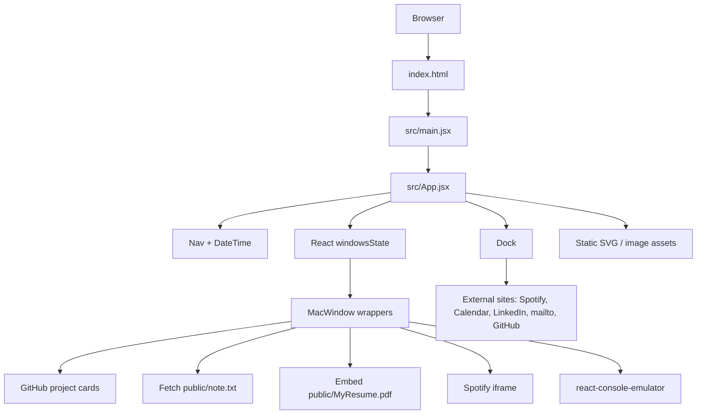

# x-service — Implementation Reference

## Purpose and scope

This document records the implementation found in the repository `VishwakarmaSanket/Web_based_MAC_OS` (default branch: `main`) as inspected on 2026-10-16. The requested name `x-service.md` is retained, but **the repository does not contain an `x-service/` directory or a backend service**. The implementation is a Vite-built React browser application that simulates a macOS-like desktop for a portfolio.

The document therefore describes the actual frontend execution flows and explicitly inventories backend features that are absent from the checked-in source. It does not claim that the UI is a real operating system, terminal shell, database-backed service, or API server.

## Table of contents

- [Architecture overview](#architecture-overview)
- [Repository inventory](#repository-inventory)
- [Startup and build lifecycle](#startup-and-build-lifecycle)
- [Endpoint and network interface inventory](#endpoint-and-network-interface-inventory)
- [Frontend execution flows](#frontend-execution-flows)
  - [Desktop and window state](#desktop-and-window-state)
  - [Dock actions](#dock-actions)
  - [Project browser](#project-browser)
  - [Notes viewer](#notes-viewer)
  - [Resume viewer](#resume-viewer)
  - [Spotify embed](#spotify-embed)
  - [Terminal simulator](#terminal-simulator)
  - [Navigation date and time](#navigation-date-and-time)
- [Data entities and persisted state](#data-entities-and-persisted-state)
- [Asynchronous components](#asynchronous-components)
- [Dependencies and configuration](#dependencies-and-configuration)
- [Security, errors, and operational observations](#security-errors-and-operational-observations)
- [Verification notes and limitations](#verification-notes-and-limitations)

## Architecture overview

### High-level architecture



The code is a client-rendered React application. The principal entry is `index.html` → `src/main.jsx` → `src/App.jsx`. The app keeps a boolean map of open windows in React state. The dock toggles each window to open; each window's red control sets its corresponding map entry to false.

No server-side route table, API controller, database driver/model, authentication middleware, message broker, queue, cron process, or background worker is present in the inspected repository. The only explicit app-initiated fetch in the source is a browser request for the static `note.txt` asset; the PDF and Spotify content are loaded through browser embeds.

### Runtime component map

| File | Responsibility |
|---|---|
| `index.html` | HTML document, root element, entry script and document title |
| `src/main.jsx` | Creates React root and renders `App` under `StrictMode` |
| `src/App.jsx` | Owns `windowsState`; composes top navigation, dock, and conditional windows |
| `src/components/Nav.jsx` | Static macOS-style navigation labels and Wi-Fi icon; includes `DateTime` |
| `src/components/DateTime.jsx` | Updates and formats local browser date/time every second |
| `src/components/Dock.jsx` | App launcher; opens internal windows or invokes external browser/mail actions |
| `src/components/windows/MacWindow.jsx` | Reusable draggable/resizable wrapper using `react-rnd`; red control closes the window |
| `src/components/windows/Github.jsx` | Renders project cards from `src/assets/github.json` |
| `src/components/windows/Note.jsx` | Fetches and displays the static text note using a syntax highlighter |
| `src/components/windows/Resume.jsx` | Embeds `public/MyResume.pdf` |
| `src/components/windows/Spotify.jsx` | Embeds a Spotify playlist iframe |
| `src/components/windows/Cli.jsx` | Configures a simulated command console and local command handlers |
| `src/assets/github.json` | Static project-card data |
| `public/note.txt` | Static profile/skills/project text fetched by Notes window |
| `public/MyResume.pdf` | Resume document embedded by Resume window |
| `public/doc-icons/*.svg` | Dock icons |
| `public/navbar-icons/*.svg` | Navigation bar icons |
| `src/app.scss`, component SCSS files | Desktop background, dock, navigation, window and content presentation |
| `vite.config.js` | Vite React plugin and deployment base path |
| `package.json` | Scripts and runtime/development dependencies |
| `eslint.config.js` | ESLint configuration |

## Repository inventory

The complete Git tree on `main` was inspected. The tree contains root config/docs, `latest/src/App.jsx`, `src/`, and `public/`, but no `x-service/` folder. The `latest/src/App.jsx` path is a separate minimal file in the tree and is not imported by the active entry point; the active app imports `src/App.jsx`.

Files inspected for this document:

- Root: `.gitignore`, `README.md`, `package.json`, `index.html`, `vite.config.js`, `eslint.config.js`
- App: `src/App.jsx`, `src/main.jsx`, `src/app.scss`
- Components: `src/components/DateTime.jsx`, `Dock.jsx`, `Nav.jsx`, `dock.scss`, `nav.scss`
- Windows: `Cli.jsx`, `Github.jsx`, `MacWindow.jsx`, `Note.jsx`, `Resume.jsx`, `Spotify.jsx`, and corresponding SCSS files
- Data/assets: `src/assets/github.json`, `public/note.txt`, dock and navbar SVGs
- The tree also contains `public/MyResume.pdf`, `public/wallpaper.jpg`, `public/wallpaper2.jpg`, `public/vite.svg`, and `latest/src/App.jsx`.

## Startup and build lifecycle

### Browser startup

1. Browser loads `index.html`, which defines `<div id="root"></div>` and imports `/src/main.jsx`.
2. `src/main.jsx` calls `createRoot(document.getElementById("root"))` and renders `<App />` under `React.StrictMode`.
3. `src/App.jsx` initializes `windowsState` to all false:
   `github`, `note`, `resume`, `spotify`, and `cli`.
4. It renders `Nav` and `Dock`; each feature window is conditionally mounted only when its state flag is true.
5. The `main` element receives the desktop styling from `src/app.scss`, including wallpaper, full-screen sizing, and overflow clipping.

### Commands

| Command | Implementation |
|---|---|
| `npm run dev` | Starts Vite development server |
| `npm run build` | Runs `vite build` |
| `npm run preview` | Runs Vite preview server |
| `npm run lint` | Runs `eslint .` |
| `npm run predeploy` | Runs production build before deployment |
| `npm run deploy` | Runs `gh-pages -d dist` |

`vite.config.js` sets `base: "/Web_based_MAC_OS/"` and installs `@vitejs/plugin-react`. Static paths built with `import.meta.env.BASE_URL` respect this base for dock icons, `note.txt`, and the PDF. In contrast, the wallpaper in `src/app.scss` and the navbar icon paths in `Nav.jsx` are written as root-relative/relative URLs rather than using `BASE_URL`; treat that as a deployment-path observation, not a guaranteed failure in every serving arrangement.

## Endpoint and network interface inventory

### Backend endpoints: none found

The checked-in application has no HTTP server code and no registered application API routes. Consequently there are no backend methods, route parameters, request DTOs, database transactions, HTTP status contracts, or application-generated API error envelopes to enumerate. Do not use the simulated CLI or desktop window labels as evidence of server endpoints.

### Browser network/external interfaces

These are browser resource requests or embeds, not endpoints implemented by this repository.

| Interface | Initiator | Method/route | Inputs | Response/handling |
|---|---|---|---|---|
| Notes text asset | `src/components/windows/Note.jsx` | Browser `fetch()` to `${import.meta.env.BASE_URL}note.txt` (normally `/Web_based_MAC_OS/note.txt` in the configured build) | No explicit headers, query, body, or path variables | Calls `res.text()`, then stores text in component state. No `res.ok` check or `.catch()` handler. |
| Resume document | `src/components/windows/Resume.jsx` | Browser `embed` source `${BASE_URL}MyResume.pdf` | Static asset URL | Browser PDF/plugin viewer behavior; no app-level response parsing or error handling |
| Spotify playlist | `src/components/windows/Spotify.jsx` | Third-party iframe URL `https://open.spotify.com/embed/playlist/37i9dQZF1DX0XUfTFmNBRM?utm_source=generator&theme=0` | Fixed playlist ID and query parameters | Third-party page rendered in iframe; errors/auth/playback are handled by Spotify/browser, not by an app server |
| Calendar | `src/components/Dock.jsx` | `window.open("https://calendar.google.com", "_blank")` | None | Opens external site in a new tab/window if browser allows it |
| Email | `src/components/Dock.jsx` | `window.open("mailto:sanketvkarma10@gmail.com", "_blank")` | Fixed mailto recipient | Delegates to browser/OS mail handler |
| LinkedIn | `src/components/Dock.jsx` | `window.open("https://www.linkedin.com/in/sanket-vishwakarma-361224338/", "_blank")` | None | Opens external profile |
| GitHub profile | `src/components/windows/Cli.jsx` command `github` | `window.open("https://github.com/VishwakarmaSanket", "_blank")` | CLI command name | Opens external profile; console returns a confirmation string |

For these browser interfaces, success depends on asset availability, browser policy, external service availability, and (for embedded content) third-party behavior. There are no app-defined HTTP status codes or JSON response shapes for them.

### Notes asset execution walkthrough and errors

1. The dock's Notes icon sets `windowsState.note = true`.
2. `App` mounts `Note`, wrapped in `MacWindow`.
3. On mount, `Note` runs `fetch(`${import.meta.env.BASE_URL}note.txt`)`.
4. When the request resolves, the implementation calls `res.text()` and stores the resulting string in `markdown`.
5. While `markdown` is falsy, the UI displays `Loading...`; after non-empty text arrives, the text is rendered by `react-syntax-highlighter` as TypeScript with `atelierDuneDark`.
6. There is no explicit status-code validation, timeout, retry, abort, or rejection handler. A rejected fetch can leave the component on its loading state and may produce an unhandled promise rejection. A successful empty response is also falsy and would continue to show loading. This is a code-based risk observation.

## Frontend execution flows

### Desktop and window state

**Entry point:** `src/App.jsx`; reusable window wrapper in `src/components/windows/MacWindow.jsx`.

1. `App` creates a React state object with five boolean fields initially false.
2. It passes `windowsState` and `setWindowsState` into `Dock`.
3. Each app icon's click handler updates only its corresponding field with a functional state updater, preserving other fields via spread.
4. `App` conditionally renders each matching window if its field is true.
5. Each window receives `windowName` plus `setWindowsState`. The shared `MacWindow` puts its children in a `react-rnd` component configured to be draggable by the element whose class is `nav`, resizable, and initially positioned at `x: 300, y: 200`. Default size is `40vw × 40vh`; Spotify overrides width to `35vw`.
6. The red dot's `onMouseDown` stops propagation and sets `state[windowName] = false`, causing React to unmount the window.
7. Yellow and green dots have no handlers in this implementation. No minimize, maximize, persistence, focus/z-index management logic or geometry persistence is defined in app code.

State lives only in the mounted React application; no local storage, URL state, or backend persistence is used.

### Dock actions

**Entry point:** `src/components/Dock.jsx`.

| Dock icon | Click behavior | Effects |
|---|---|---|
| GitHub | Sets `github: true` | Mounts project-card window; also writes current `windowsState` to console |
| Note | Sets `note: true` | Mounts Notes window and starts static-text fetch |
| PDF | Sets `resume: true` | Mounts PDF embed |
| Calendar | Opens Google Calendar in a new tab/window | External navigation |
| Spotify | Sets `spotify: true` | Mounts Spotify iframe |
| Mail | Opens fixed `mailto:` target | External mail-handler invocation |
| Link | Opens the configured LinkedIn profile | External navigation |
| CLI | Sets `cli: true` | Mounts local console simulator |

The dock does not toggle an already-open window closed; click handlers assign `true`. Closing is implemented by the red control in `MacWindow`.

### Project browser

**Files:** `src/components/windows/Github.jsx`, `src/assets/github.json`, `src/components/windows/github.scss`.

1. Opening GitHub in the dock mounts `Github`.
2. The module statically imports JSON project data; no network API is used to retrieve project metadata.
3. `Github` maps each item to a `GitCard` keyed by `project.id`.
4. `GitCard` renders image, title, description, tags, and links.
5. The JSON uses camelCase keys `repoLink` and `demoLink`, but the component reads `data.repolink` and `data.demolink`. JavaScript property lookup is case-sensitive, so the repository anchors receive undefined hrefs and the demo-link condition is false with the current data. This mismatch is a confirmed implementation issue; it is documented as an observation and not silently corrected here.
6. The tags are rendered from `data.tags`; the tag `map` does not provide a React key for individual tag paragraphs. The repository cards themselves do use the project ID as a key.

No server state is read or modified. Images are remote Unsplash URLs declared in JSON; opening repository/demo anchors is subject to the link-key mismatch noted above.

### Notes viewer

**Files:** `src/components/windows/Note.jsx`, `public/note.txt`, `src/components/windows/note.scss`.

The flow is detailed in [Notes asset execution walkthrough](#notes-asset-execution-walkthrough-and-errors). Despite importing `react-markdown` as `Markdown`, that symbol is not used. The content is displayed by `SyntaxHighlighter` with `language="typescript"`, so Markdown syntax in the text is not rendered as rich Markdown. The effect has an empty dependency list and has no cleanup or explicit fetch error handling.

### Resume viewer

**Files:** `src/components/windows/Resume.jsx`, `public/MyResume.pdf`, `src/components/windows/resume.scss`.

1. Clicking the PDF dock icon sets `resume` to true.
2. `App` mounts `Resume` inside `MacWindow`.
3. A browser `embed` points at `${import.meta.env.BASE_URL}MyResume.pdf`, taking advantage of Vite's base path.
4. The embedded document is displayed at 100% width and height within `.resume-window`.

No PDF parsing, upload, conversion, download API, authentication, or persistence code is implemented.

### Spotify embed

**Files:** `src/components/windows/Spotify.jsx`, `src/components/windows/spotify.scss`.

1. Clicking Spotify sets `windowsState.spotify = true`.
2. `App` mounts `Spotify` and wraps the iframe in `MacWindow`.
3. The iframe loads a fixed Spotify playlist URL, uses lazy loading, allows autoplay/clipboard/encrypted-media/fullscreen/picture-in-picture, and has a 352px HTML height attribute.
4. SCSS gives the containing element `min-height: 450px` and the iframe `height: 100%`.

The code does not call Spotify APIs, store tokens, or handle Spotify playback events. The `style` prop passed to `MacWindow` is not declared/destructured by that component and is therefore ignored; `MacWindow`'s `Rnd` receives its own defaults and the supplied width `35vw`. Actual playback and responsive embed behavior are controlled by the third-party iframe/browser.

### Terminal simulator

**Files:** `src/components/windows/Cli.jsx`, `src/components/windows/cli.scss`, dependency `react-console-emulator`.

This is an in-browser command emulator, not a shell process. Its command table has handlers defined locally:

| Command | Behavior |
|---|---|
| `about` | Returns a hard-coded profile paragraph |
| `skills` | Returns hard-coded skill groups |
| `projects` | Returns a hard-coded numbered list |
| `experience` | Returns hard-coded academic/project experience |
| `contact` | Returns name, location, GitHub, and placeholder email text |
| `github` | Opens GitHub profile in a new tab and returns “Opening GitHub profile...” |
| `resume` | Returns “Resume download started...” only; no download is initiated by this handler |
| `social` | Returns GitHub and placeholder LinkedIn text |
| `neofetch` | Returns the constructed welcome/system banner |
| `matrix` | Returns a static “Connection Terminated” string |
| `echo <string>` | Joins passed arguments with spaces |
| `help`, `clear` | Mentioned in the banner, but no matching custom handler is defined in the `commands` object; any default behavior depends on `react-console-emulator` |

1. Mounting CLI constructs `welcomeMessage` using current `new Date().toLocaleTimeString()`.
2. It defines command metadata with a description, usage string, and local function for each configured command.
3. `Terminal` receives the command table and welcome message, autofocus, smooth scroll behavior, prompt styling and terminal content styles.
4. When the user enters a command supported by the emulator, its local function returns text or performs the GitHub `window.open` side effect.
5. There is no network request, actual shell spawning, filesystem access, environment inspection, or backend process behind the displayed “zsh” branding.

Some banner strings describe a simulated OS/kernel and show a contact email placeholder; they are presentation copy, not verified runtime environment metadata. The `resume` command output is only a string and does not cause a browser download.

### Navigation date and time

**Files:** `src/components/Nav.jsx`, `src/components/DateTime.jsx`.

1. `Nav` renders fixed labels and local SVG icons, then mounts `DateTime`.
2. `DateTime` initializes state with `new Date()`.
3. A `useEffect` creates a 1-second interval that replaces the state with a fresh `Date`.
4. Cleanup clears the interval when the component unmounts.
5. Formatting uses browser-local `getDay`, `getMonth`, `getDate`, and `getHours`; it converts to 12-hour time and pads minutes to two digits. The month is lowercased in output.

This is local system time, not a server-synchronized clock. The displayed labels File, Window, and Terminal do not have click handlers in the checked-in JSX.

## Data entities and persisted state

### No database entities

No SQL/NoSQL driver, ORM, schema/model definition, migration, database connection, collection, or table usage was found in the inspected application files. No database schema can therefore be truthfully documented.

### Runtime state: `windowsState`

This is React component state in `src/App.jsx`, not a database entity.

| Field | Type | Initial value | Meaning |
|---|---|---:|---|
| `github` | boolean | `false` | Whether the project browser is mounted |
| `note` | boolean | `false` | Whether the notes window is mounted |
| `resume` | boolean | `false` | Whether the resume embed is mounted |
| `spotify` | boolean | `false` | Whether the Spotify embed is mounted |
| `cli` | boolean | `false` | Whether the CLI simulator is mounted |

There are no schema validators, defaults outside the initial state object, indexes, foreign keys, or cross-record relationships. State is recreated on page reload.

### Static project records

**Source:** `src/assets/github.json` (five array entries).

The JSON records contain these properties in the checked-in file:

| Field | Observed type | Notes |
|---|---|---|
| `id` | number | Values 1–5; used as the project-card React key |
| `image` | string | Remote Unsplash image URL |
| `title` | string | Project title |
| `description` | string | Project summary |
| `tags` | string array | Technology/topic labels |
| `repoLink` | string | Repository URL in source data |
| `demoLink` | string | Demo URL in source data |

These are static build-time data, not validated database records. The UI component expects `repolink` and `demolink` (lowercase) rather than the actual camelCase properties, as described in [Project browser](#project-browser).

Representative entry, preserving source key casing:

```json
{
  "id": 1,
  "image": "https://images.unsplash.com/photo-1522071820081-009f0129c71c",
  "title": "Horizon Courts Website",
  "description": "A modern and responsive tennis club website built using React, Vite, and Tailwind CSS. Focused on clean UI, responsiveness, and smooth user experience.",
  "tags": ["React", "Vite", "Tailwind CSS", "JavaScript"],
  "repoLink": "https://github.com/VishwakarmaSanket/Horizon-courts-website",
  "demoLink": "https://vishwakarmasanket.github.io/Horizon-courts-website/"
}
```

### Static public assets

- `public/note.txt`: text content describing technologies, projects, academic focus, principles, and status. At runtime it is fetched as plain text.
- `public/MyResume.pdf`: PDF embedded directly by the resume window.
- `public/wallpaper.jpg` and `public/wallpaper2.jpg`: image assets in the public tree; `src/app.scss` uses `/wallpaper2.jpg`.
- SVG files beneath `public/doc-icons/` and `public/navbar-icons/`: visual assets only.

There is no application lifecycle for creating/updating/deleting these assets at runtime.

## Asynchronous components

### React interval

- **Initializer:** `DateTime` mounts.
- **Trigger:** `setInterval(..., 1000)`.
- **Payload:** None; refreshes state with `new Date()`.
- **Effect:** Rerenders formatted local date/time.
- **Cleanup:** `clearInterval(timer)` on unmount.
- **Retry/concurrency/queue/ack:** Not applicable.

### Notes fetch

- **Initializer:** `Note` mounts.
- **Trigger:** `useEffect` with empty dependency array.
- **Request:** fetches static `note.txt` under configured base URL.
- **Success path:** response body converted to text and saved as state.
- **Failure behavior:** no catch, retry, timeout, abort, or explicit status check in app code.
- **Cancellation:** no abort controller; if component unmounts before resolution, there is no explicit cancellation logic.
- **Queue/scheduler:** none.

### Third-party iframe/embed loading

- Spotify is loaded by the browser through the iframe; no internal message consumer or event handler is registered.
- The PDF is loaded by the browser's embed element; there is no app-level asynchronous processing around its response.

No producers/consumers, event handlers, queue jobs, workers, cron jobs, scheduled backend tasks, dead-letter queues, retries, or message acknowledgements were found.

## Dependencies and configuration

### Runtime dependencies

| Package | Version range in `package.json` | Observed usage |
|---|---|---|
| `react` | `^19.2.0` | Components and state/effect hooks |
| `react-dom` | `^19.2.0` | Browser rendering via `createRoot` |
| `react-console-emulator` | `^5.0.2` | CLI-like UI |
| `react-markdown` | `^10.1.0` | Imported in Notes component as `Markdown`, but unused |
| `react-rnd` | `^10.5.2` | Drag/resize window wrapper |
| `react-syntax-highlighter` | `^16.1.0` | Renders note text with syntax theme |
| `sass` | `^1.97.3` | SCSS styles |
 
### Development dependencies

| Package | Version range | Purpose in configuration |
|---|---|---|
| `vite` | `^7.2.4` | Dev server and production build |
| `@vitejs/plugin-react` | `^5.1.1` | React support in Vite |
| `eslint` | `^9.39.1` | Lint script |
| `@eslint/js` | `^9.39.1` | ESLint recommended JavaScript rules |
| `eslint-plugin-react-hooks` | `^7.0.1` | React Hooks lint rules |
| `eslint-plugin-react-refresh` | `^0.4.24` | Vite/React refresh lint config |
| `globals` | `^16.5.0` | Browser globals for ESLint |
| `@types/react`, `@types/react-dom` | ranges in package file | React type definitions; app source is JSX/JavaScript |
| `gh-pages` | `^6.3.0` | Publishes `dist` with `gh-pages -d dist` |

### Environment variables and secrets

No custom `process.env` or named application environment variable is used by the source. It does use Vite's built-in `import.meta.env.BASE_URL` in the dock icon paths, Notes fetch, and PDF embed. `BASE_URL` is controlled by Vite configuration (currently `/Web_based_MAC_OS/`). No API keys, credentials, secrets, authentication tokens, database URLs, or broker credentials are declared in the checked source files.

### Authentication and authorization

There is no application authentication or authorization layer, login flow, role check, session handling, API middleware, request validation middleware, or CSRF protection code. The app is a static frontend. External services may have their own authentication and browser policies, which are outside this repository.

## Security, errors, and operational observations

The items below are code-review observations, not claims about a confirmed production incident.

1. **Project links casing mismatch:** the JSON's `repoLink`/`demoLink` keys do not match the component's `repolink`/`demolink` lookups. Current source behavior therefore does not supply the intended URLs to the anchors.
2. **Notes fetch lacks error-state handling:** no `response.ok` check, `.catch()`, retry, timeout, or loading-error UI. A missing/failed asset can leave the display at `Loading...`.
3. **Static note rendered as code:** `react-markdown` is imported but unused; the note is presented through a TypeScript syntax highlighter. This is a presentation decision/implementation mismatch, not a server concern.
4. **CLI copy vs real behavior:** displayed shell/OS details are hard-coded UI text. `resume` says a download started but its command handler does not initiate one. The banner mentions `help` and `clear` but they are absent from the custom command map; any behavior for those names depends on the installed console library.
5. **Window controls are partial:** only the red dot has a close handler. Yellow and green controls do nothing in the checked-in component.
6. **Ignored `style` prop:** `Spotify` passes a `style` prop to `MacWindow`, but `MacWindow` does not destructure/use it. The `Rnd` sizing is controlled by its `default` config and the explicit `width` prop.
7. **No explicit iframe link isolation policy:** project-card anchors do not declare `target` or `rel`; the current implementation does not implement an explicit external-link opening/security policy for those anchors.
8. **Static external dependencies:** project images and Spotify content rely on remote providers. Their availability and behavior are not controlled by the app.
9. **Base-path consistency:** Vite's base is `/Web_based_MAC_OS/`; some icon/background paths are not composed using `BASE_URL`. Deployment at a subpath should be verified for those paths.
10. **No server observability/operations layer:** no app logger, metrics, traces, health/readiness endpoint, centralized exception middleware, graceful server shutdown, database transactions, cache invalidation, rate limits, or server request timeouts are implemented in this repository. Browser console output includes a `console.log(windowsState)` in the GitHub dock handler.

There is no server resource cleanup beyond React effect cleanup in `DateTime`. No database consistency/transaction boundary can be described because no database operations are implemented.

## Verification notes and limitations

- The Git tree on `main` was enumerated recursively and was not marked truncated.
- All application JSX, SCSS, root build/configuration files, static JSON/text files, and the SVG icons were reviewed.
- The repo contains no `x-service/` directory, backend server entry point, API route registration, model definitions, database adapter, queue/scheduler configuration, or external-service client module to trace.
- The repository README describes a portfolio UI, and the live deployment URL in the README points to GitHub Pages. Documentation of hosted infrastructure beyond the committed source is intentionally excluded.
- `package-lock.json` is present and was visible in the tree, but the dependency table above follows direct declarations in `package.json`; transitive dependency implementation details are outside this service-level reference.
- `public/MyResume.pdf` is treated as a static document; its content is not repeated in this technical document.
- No tests or runtime execution were performed as part of this source inspection, so this document describes static implementation behavior rather than verified browser behavior across all environments.

## Quick reference

- **Application entry:** `index.html` → `src/main.jsx` → `src/App.jsx`
- **State owner:** `App` (`windowsState`)
- **Window wrapper:** `src/components/windows/MacWindow.jsx`
- **Only explicit application fetch:** `Note.jsx` → static `note.txt`
- **Project source data:** `src/assets/github.json`
- **Configured Vite base:** `/Web_based_MAC_OS/`
- **Backend API endpoints, database models, message queues, and schedulers:** none found in the checked-in implementation
